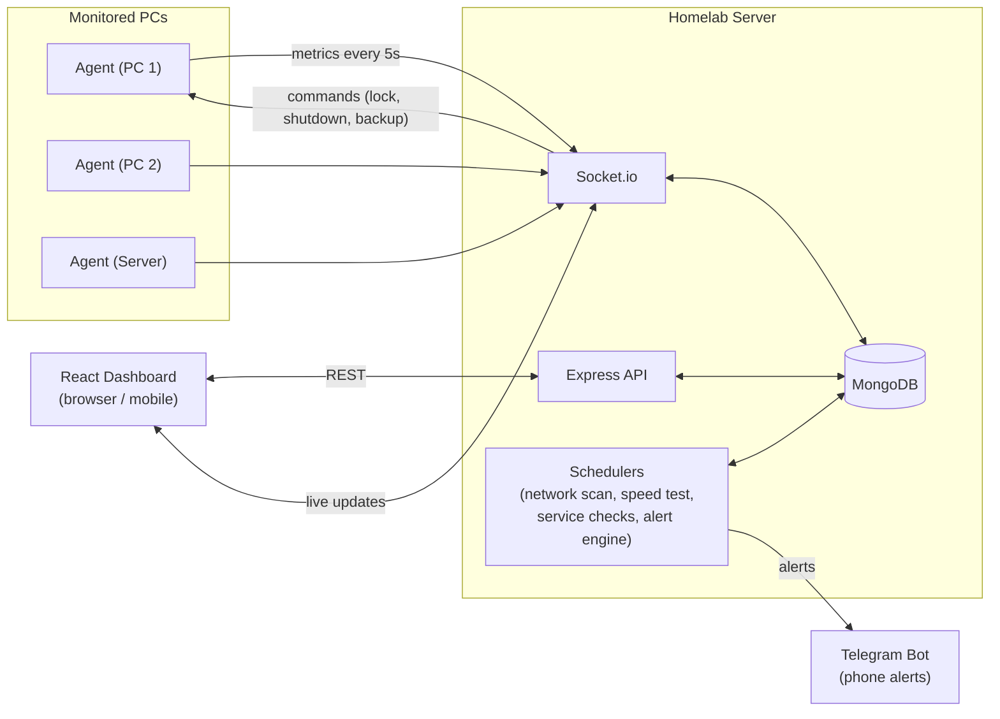
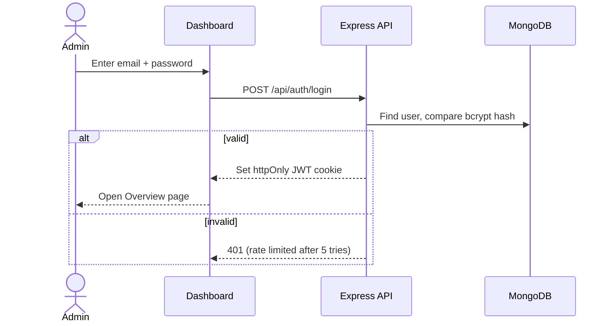
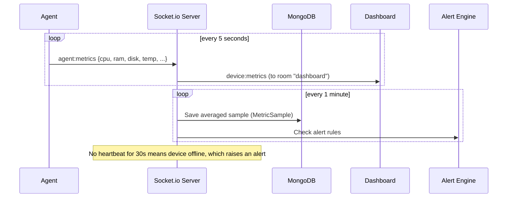
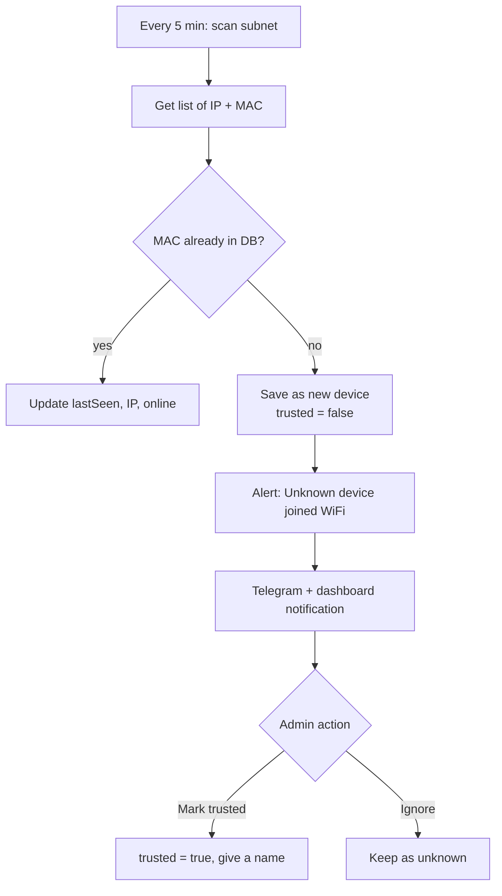
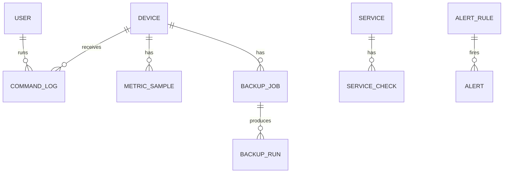

# Homelab Dashboard: Project Plan

Final Year Project (FYP). A self-hosted MERN dashboard to monitor and manage personal PCs, the home network, and home servers from one place, with mobile alerts.

Related files:

- [PENDING.md](PENDING.md): tasks still to do
- [DONE.md](DONE.md): completed tasks

---

## 1. Problem statement

A person running a few PCs, a home WiFi network, and a small server has no single place to see what is happening:

- A PC gets slow or the disk fills up, and nobody notices until it breaks.
- Unknown devices join the WiFi and nobody knows.
- The internet goes down or gets slow, and there is no record to show the ISP.
- A service (website, database) stops, and nobody knows until someone complains.
- Backups are manual, so they are often skipped.

Existing tools (Zabbix, Grafana, Uptime Kuma, Pi-hole) each solve one part, are complex to set up, and are built for companies, not homes or small labs.

## 2. Solution

One web dashboard that:

1. Shows live health of every PC (CPU, RAM, disk, temperature, battery, top processes).
2. Scans the network and alerts on unknown devices.
3. Tracks internet speed and downtime history.
4. Checks whether services and websites are up.
5. Runs scheduled backups and allows restore.
6. Sends alerts to the phone through a Telegram bot.
7. Allows safe remote actions (lock, restart, shutdown) on PCs.

## 3. Objectives

- Build a working, deployable system used daily by the developer (real usage, live demo in viva).
- Keep the setup simple: one server, one small agent per PC.
- Keep it secure: login, token-based agents, whitelisted remote commands.

## 4. Scope

**In scope**

- Windows and Linux PCs (agent runs on both through Node.js).
- One home network (one subnet).
- One admin user (with an optional read-only viewer role).

**Out of scope**

- Managing networks of companies or multiple sites.
- Packet-level deep inspection or a full intrusion detection system.
- Native mobile app (the web dashboard is responsive and works on mobile).

---

## 5. Tech stack

| Layer | Technology | Purpose |
|---|---|---|
| Frontend | React (Vite) + Tailwind CSS | Dashboard UI |
| UI components | shadcn/ui (Radix UI + Tailwind) | Reusable, accessible components copied into `client/src/components/ui/` |
| Server state | TanStack Query (`@tanstack/react-query`) | Fetching, caching, refetching, mutations, invalidation |
| Tables | TanStack Table (`@tanstack/react-table`) | Sorting, filtering, pagination (base of the shadcn Data Table) |
| HTTP client | Native `fetch` wrapper (`client/src/api/client.js`) | Used by API services under TanStack Query |
| Charts | Recharts through the shadcn `Chart` component | Live and history graphs |
| Icons | `lucide-react` (comes with shadcn) | Icons |
| Toasts | shadcn `Sonner` | Live alert toasts |
| Backend | Node.js + Express | REST API |
| Real-time | Socket.io | Live metrics from agents to server to browser |
| Database | MongoDB + Mongoose | Devices, metrics, logs, settings |
| Auth | JWT (httpOnly cookie) + bcryptjs | Admin login |
| Validation | Zod | Request and agent payload validation |
| Routing (client) | React Router | Pages and protected routes |
| Theme | Own `ThemeProvider` (light / dark / system) | Replaces `next-themes`, which logs errors with React 19 in Vite |
| Dev server | nodemon (watches `src/` only) | Node's `--watch` restarts on `node_modules` changes on Windows |
| Agent | Node.js script | Runs on every monitored PC |
| Package manager | npm | Per project rules |
| Linting / format | oxlint + Prettier | Same linter in client, server, agent |

### Planned packages per module

| Module | Package | Runs on |
|---|---|---|
| PC metrics | `systeminformation` | Agent |
| Network scan | `local-devices` (ARP table) + ICMP ping | Server |
| Internet speed | `speedtest-net` (or Ookla CLI through `child_process`) | Server |
| Service checks | built-in `fetch` (HTTP) + `net` (TCP) | Server |
| Scheduling | `node-cron` | Server and agent |
| Backups | `archiver` (zip) | Agent |
| Alerts | `node-telegram-bot-api` | Server |
| Security | `helmet`, `express-rate-limit`, `cors` | Server |

Packages are installed only when the module that needs them is built.

---

## 6. System architecture



### Components

| Component | Responsibility |
|---|---|
| **Agent** | Collects system metrics, sends them to the server, runs approved commands, runs backups of local folders. |
| **Server (API)** | Auth, CRUD for devices, services, backup jobs, alert rules, settings. Serves history data. |
| **Server (Socket.io)** | Receives live metrics from agents, pushes live data to browsers, sends commands to agents. |
| **Server (Schedulers)** | Network scan, speed test, service checks, alert rule evaluation, old data cleanup. |
| **Dashboard** | Shows everything, lets the admin configure and act. |
| **Telegram bot** | Sends alerts to the phone. Optional later: reply commands like `/status`. |

---

## 7. Main flows

### 7.1 Admin login



### 7.2 Add a new PC (agent registration)

1. Admin clicks **Add Device** in the dashboard and enters a name.
2. Server creates the device and returns a one-time **agent token** (stored hashed in DB).
3. Admin installs the agent on the PC and puts the server URL and token in the agent `.env`.
4. Agent connects through Socket.io with the token.
5. Server verifies the token, marks the device **online**, and the dashboard shows it live.

### 7.3 Live metrics



Live data goes straight to the browser. Only one averaged sample per minute is saved, to keep the database small. Old samples are removed automatically (TTL index, for example 30 days).

### 7.4 Network scan and new device alert



### 7.5 Alert flow

1. A check produces a value (CPU 95%, service down, new device, PC offline).
2. The alert engine compares it with **alert rules** (for example: CPU > 90% for 5 minutes).
3. If a rule fires and there is no open alert for the same rule and device, a new alert is created (this prevents spam).
4. A notification goes to the Telegram bot and the dashboard (live toast and bell icon).
5. When the value is normal again, the alert is marked **resolved** and an optional "resolved" message is sent.

### 7.6 Remote command (lock, restart, shutdown)

1. Admin clicks **Shutdown** on a device page and confirms it in a dialog.
2. API checks that the user is an admin and the command is in the **whitelist** (`lock`, `restart`, `shutdown`, `run-backup`).
3. Server sends `agent:command` to that agent only.
4. Agent runs the matching fixed OS command (never raw text from the server) and replies with the result.
5. The command and its result are saved in **CommandLog** for audit.

### 7.7 Backup

1. Admin creates a backup job: device, source folders, destination, schedule (cron), how many copies to keep.
2. At the scheduled time, the server sends `agent:backup` to the agent.
3. Agent zips the folders, saves them to the destination, and deletes copies older than the keep limit.
4. Agent reports success or failure and the size. A failure creates an alert.
5. Restore: admin selects a backup run and clicks **Restore**, and the agent unzips it to a chosen folder.

---

## 8. Database design (MongoDB collections)



| Collection | Key fields |
|---|---|
| **User** | name, email (unique), passwordHash, role (`admin` / `viewer`), createdAt |
| **Device** (PC with agent) | name, hostname, os, agentTokenHash, status (`online` / `offline`), lastSeen, specs (cpu model, total RAM, disks) |
| **MetricSample** | deviceId, timestamp, cpu %, ram %, disk[] %, tempC, battery %, netRx, netTx. TTL index. |
| **NetworkDevice** | mac (unique), ip, vendor, customName, trusted (bool), online, firstSeen, lastSeen |
| **SpeedTest** | timestamp, downloadMbps, uploadMbps, pingMs, success |
| **Service** | name, type (`http` / `tcp`), target (URL or host:port), intervalSec, expectedStatus, enabled |
| **ServiceCheck** | serviceId, timestamp, up (bool), responseMs, error. TTL index. |
| **BackupJob** | deviceId, name, sources[], destination, cron, keepLast, enabled |
| **BackupRun** | jobId, startedAt, finishedAt, status, sizeBytes, filePath, error |
| **AlertRule** | name, type (`cpu`, `ram`, `disk`, `temp`, `offline`, `service_down`, `new_device`, `backup_failed`), threshold, durationSec, targetId (optional), enabled |
| **Alert** | ruleId, targetId, message, severity, status (`open` / `resolved`), createdAt, resolvedAt, notified |
| **CommandLog** | userId, deviceId, command, status, output, createdAt |
| **Settings** | telegramChatId, scanSubnet, scanIntervalMin, retentionDays |

Secrets (JWT secret, Telegram bot token, MongoDB URI) stay in `.env`, never in the database or Git.

---

## 9. API design (REST)

All routes except login need a valid JWT. Write routes need the `admin` role.

| Method | Route | Purpose |
|---|---|---|
| POST | `/api/auth/login` | Login |
| POST | `/api/auth/logout` | Logout |
| GET | `/api/auth/me` | Current user |
| GET | `/api/overview` | Summary counts for the Overview page |
| GET | `/api/devices` | List PCs |
| POST | `/api/devices` | Add PC, returns agent token once |
| GET | `/api/devices/:id` | PC details |
| PATCH | `/api/devices/:id` | Rename or edit |
| DELETE | `/api/devices/:id` | Remove PC |
| POST | `/api/devices/:id/token` | Regenerate agent token |
| GET | `/api/devices/:id/metrics?range=1h\|24h\|7d` | Metric history |
| POST | `/api/devices/:id/commands` | Send whitelisted command |
| GET | `/api/network/devices` | Network device list |
| PATCH | `/api/network/devices/:id` | Rename, mark trusted |
| POST | `/api/network/scan` | Scan now |
| GET | `/api/internet/speedtests?range=` | Speed history |
| POST | `/api/internet/speedtests` | Run test now |
| GET / POST | `/api/services` | List or add services |
| PATCH / DELETE | `/api/services/:id` | Edit or remove |
| GET | `/api/services/:id/checks?range=` | Uptime history |
| GET / POST | `/api/backups/jobs` | List or create jobs |
| PATCH / DELETE | `/api/backups/jobs/:id` | Edit or remove |
| POST | `/api/backups/jobs/:id/run` | Run now |
| GET | `/api/backups/runs` | Backup history |
| POST | `/api/backups/runs/:id/restore` | Restore |
| GET | `/api/alerts?status=` | Alert list |
| PATCH | `/api/alerts/:id` | Acknowledge or resolve |
| GET / POST / PATCH / DELETE | `/api/alert-rules` | Manage rules |
| GET / PATCH | `/api/settings` | App settings |
| POST | `/api/settings/telegram/test` | Send test message |

## 10. Socket.io events

| Event | Direction | Payload |
|---|---|---|
| `agent:hello` | Agent → Server | token, hostname, os, specs |
| `agent:metrics` | Agent → Server | cpu, ram, disks, temp, battery, net, topProcesses |
| `agent:command` | Server → Agent | commandId, command |
| `agent:command:result` | Agent → Server | commandId, status, output |
| `agent:backup` | Server → Agent | runId, sources, destination, keepLast |
| `agent:backup:result` | Agent → Server | runId, status, sizeBytes, filePath, error |
| `device:metrics` | Server → Dashboard | deviceId + latest metrics |
| `device:status` | Server → Dashboard | deviceId, online/offline |
| `alert:new` | Server → Dashboard | alert |
| `network:update` | Server → Dashboard | changed network devices |

Agents and browsers use separate Socket.io namespaces (`/agent` and `/dashboard`), each with its own auth.

---

## 11. UI design

### 11.1 Pages

| Page | Contents |
|---|---|
| **Login** | Email, password |
| **Overview** | Status cards (PCs online, network devices, internet speed, services up, open alerts), mini charts, recent alerts |
| **Devices** | Grid of PC cards with live CPU / RAM / disk bars and an online dot |
| **Device detail** | Live charts, history range switch (1h / 24h / 7d), specs, top processes, action buttons (lock, restart, shutdown), backup jobs of this PC |
| **Network** | Table of all devices on WiFi (name, IP, MAC, vendor, trusted, last seen), "Scan now", filter unknown |
| **Internet** | Speed chart over time, downtime list, "Run test now" |
| **Services** | List with up/down status, response time, uptime % (24h, 7d) |
| **Backups** | Jobs, run history, run now, restore |
| **Alerts** | Open and resolved alerts, alert rules editor |
| **Settings** | Telegram setup and test, scan subnet, data retention, users, password change |

### 11.2 Layout

```text
+----------------------------------------------------------+
| [=] Homelab            search            (bell 3)  (user) |
+-----------+----------------------------------------------+
| Overview  |  +--------+ +--------+ +--------+ +--------+ |
| Devices   |  | PCs    | | WiFi   | | Speed  | | Alerts | |
| Network   |  | 3/4 on | | 12 dev | | 48Mbps | |   2    | |
| Internet  |  +--------+ +--------+ +--------+ +--------+ |
| Services  |                                              |
| Backups   |  +-------------------------+ +-------------+ |
| Alerts    |  | CPU / RAM (live chart)  | | Recent      | |
| Settings  |  |                         | | alerts      | |
|           |  +-------------------------+ +-------------+ |
+-----------+----------------------------------------------+
```

On mobile, the sidebar becomes a bottom tab bar or a hamburger menu, and cards stack in one column.

### 11.3 Visual style

- **Dark theme by default** (with a light theme toggle). This is common for monitoring tools and looks good in demos.
- Status colors, used the same way everywhere:

| Status | Color | Use |
|---|---|---|
| OK / online / up | Green | Healthy |
| Warning | Amber | Above warning threshold (for example CPU > 75%) |
| Critical / down | Red | Down, offline, critical threshold |
| Unknown / info | Blue or gray | New device, no data |

- Font: Inter (UI) and a monospace font for IPs, MACs, and logs.
- Colors are shadcn CSS variables (`--background`, `--primary`, ...) plus custom status tokens (`--success`, `--warning`, `--danger`), defined in `index.css` for light and `.dark`. Never hard-code colors in components.
- Every status also shows an icon or text, not color only (accessibility).
- Destructive actions (shutdown, delete, restore) always need a confirm dialog (shadcn `AlertDialog`).

### 11.4 Component system (shadcn/ui)

shadcn/ui components are copied into the project with the CLI (`npx shadcn@latest add <name>`), so we own and can edit the code. Rules:

- `components/ui/`: raw shadcn components only. Do not put business logic here.
- `components/common/`: our reusable app components built on top of shadcn.
- `features/<name>/components/`: components used by one feature only.
- Before creating a component, check whether shadcn or `components/common/` already has it.

**shadcn components we will add**

| Need | shadcn component |
|---|---|
| Layout | `sidebar`, `sheet` (mobile menu), `separator`, `scroll-area` |
| Cards and stats | `card`, `badge`, `progress`, `skeleton` |
| Forms | `field` (replaces the old `form`), `input`, `label`, `select`, `switch`, `checkbox`, `textarea` |
| Actions | `button`, `dropdown-menu`, `tooltip` |
| Dialogs | `dialog`, `alert-dialog` |
| Tables | `table` (+ TanStack Table for the Data Table pattern) |
| Navigation | `tabs` (history range 1h / 24h / 7d), `breadcrumb` |
| Feedback | `sonner` (toasts), `alert` |
| Charts | `chart` (Recharts wrapper) |

**Our reusable components (`components/common/`)**

| Component | Built from | Used in |
|---|---|---|
| `StatCard` | `card`, `skeleton` | Overview, device detail |
| `StatusBadge` (online / offline / up / down / warning) | `badge` + icon | Everywhere |
| `UsageBar` (CPU, RAM, disk with color by threshold) | `progress` | Device cards, detail |
| `MetricChart` (line/area chart with range tabs) | `chart`, `tabs` | Device detail, internet, services |
| `DataTable` (sort, filter, paginate) | `table` + TanStack Table | Network, services, alerts, backups, command log |
| `ConfirmDialog` | `alert-dialog` | Shutdown, delete, restore |
| `PageHeader` (title, description, actions) | `breadcrumb`, `button` | Every page |
| `EmptyState` / `ErrorState` | `card`, `button` | Every list |
| `FormDialog` (add / edit forms) | `dialog`, `field` | Add device, service, backup job, alert rule |
| `ThemeToggle` | `dropdown-menu` | Topbar |

### 11.5 Frontend data flow (TanStack Query)

All server data goes through TanStack Query. Components never call `fetch` directly.

```text
Page / Component
  → Feature query hook   (features/devices/hooks/useDevices.js)
  → API service          (features/devices/api.js)
  → Shared fetch client  (api/client.js, adds credentials and error handling)
  → Express API
```

Rules:

- One `QueryClient` and `QueryClientProvider` in `main.jsx` (React Query Devtools in development only).
- Query keys come from one factory per feature, for example:

```js
export const deviceKeys = {
  all: ['devices'],
  list: () => [...deviceKeys.all, 'list'],
  detail: (id) => [...deviceKeys.all, 'detail', id],
  metrics: (id, range) => [...deviceKeys.all, 'metrics', id, range],
};
```

- `useQuery` for reads, `useMutation` for writes. After a mutation, `invalidateQueries` with the matching key.
- Auth: `useMe()` query decides protected routes. On a 401 the client clears the query cache and redirects to login.

**Live data (Socket.io) with TanStack Query**

Socket.io does not replace TanStack Query. The socket pushes changes into the query cache, so every component reading that key updates automatically:

| Socket event | Cache action |
|---|---|
| `device:metrics` | `setQueryData(deviceKeys.live(id))` (latest values, last ~60 points kept for the live chart) |
| `device:status` | update the device in `deviceKeys.list()` |
| `alert:new` | invalidate `alertKeys.list()` + show `sonner` toast |
| `network:update` | invalidate `networkKeys.list()` |

History data (1h / 24h / 7d) uses normal `useQuery` with `staleTime` of about 1 minute, because samples are saved once per minute.

---

## 12. Security design

| Risk | Control |
|---|---|
| Stolen password | bcrypt hashing, login rate limit, httpOnly + SameSite cookie |
| Fake agent | Per-device random token, stored hashed, can be revoked |
| Remote code execution | Command whitelist only. The agent maps names to fixed OS commands. No raw shell input. |
| Unauthorized actions | Role check (`admin` vs `viewer`) on every write route |
| Bad input | Validate every request body and agent payload |
| Leaked secrets | `.env` only, `.env.example` without real values, `.env` in `.gitignore` |
| Exposure to internet | Runs on local network by default. Remote access through VPN (Tailscale / WireGuard), not open ports. |
| Common web attacks | `helmet`, CORS limited to dashboard origin |

---

## 13. Folder structure

```text
homelab-dashboard/
├── client/                 React dashboard (Vite)
│   ├── components.json     shadcn config
│   └── src/
│       ├── api/
│       │   ├── client.js       Shared fetch wrapper
│       │   └── queryClient.js  QueryClient setup
│       ├── components/
│       │   ├── ui/             shadcn components (generated by CLI)
│       │   └── common/         Reusable app components (StatCard, StatusBadge, DataTable, ...)
│       ├── features/
│       │   └── devices/        Same shape for network/, internet/, services/, backups/, alerts/, settings/, auth/
│       │       ├── api.js          API service functions
│       │       ├── queryKeys.js    Query key factory
│       │       ├── hooks/          useDevices, useDevice, useAddDevice, ...
│       │       └── components/     Feature-only components (DeviceCard, AddDeviceDialog, ...)
│       ├── hooks/          App-wide hooks (useSocket, useTheme)
│       ├── layouts/        AppLayout (shadcn sidebar + topbar)
│       ├── lib/utils.js    shadcn `cn()` helper
│       ├── pages/          Route pages (thin, compose feature components)
│       ├── index.css       Tailwind + shadcn theme variables
│       └── main.jsx        Providers (QueryClient, Theme, Router, Toaster)
├── server/                 Express API + Socket.io + schedulers
│   └── src/
│       ├── config/         env, db connection
│       ├── models/         Mongoose models
│       ├── routes/
│       ├── controllers/
│       ├── services/       Business logic (alertEngine, networkScanner, speedTest, serviceChecker, telegram)
│       ├── sockets/        agent and dashboard namespaces
│       ├── jobs/           node-cron schedules
│       ├── middleware/     auth, role, validate, errorHandler
│       ├── validators/
│       └── index.js
├── agent/                  Runs on every monitored PC
│   └── src/
│       ├── collectors/     metrics
│       ├── commands/       whitelisted actions
│       ├── backup/
│       └── index.js
├── docs/                   Diagrams, report, screenshots
├── .claude/rules/          AI agent rules
├── PLAN.md
├── PENDING.md
└── DONE.md
```

The project root is `Desktop/test`. `client/` and `server/` match the scoped rule paths in `.claude/rules/`.

---

## 14. Timeline (milestones)

| # | Milestone | Weeks | Output |
|---|---|---|---|
| M0 | Planning and setup | 1 to 2 | Plan, repo, folder structure, tooling |
| M1 | Auth + base layout | 3 to 4 | Login, protected routes, sidebar layout |
| M2 | Agent + live PC monitoring | 5 to 8 | Agent, live metrics, device pages, history charts |
| M3 | Network scanner | 9 to 10 | Device list, new device detection |
| M4 | Alerts + Telegram | 11 to 12 | Alert rules, alert engine, phone alerts |
| **Mid evaluation** | | ~12 | Demo M1 to M4 |
| M5 | Internet + service monitoring | 13 to 15 | Speed tests, uptime checks |
| M6 | Remote commands | 16 to 17 | Lock, restart, shutdown with audit log |
| M7 | Backups | 18 to 20 | Scheduled backups, restore |
| M8 | Polish, security, testing | 21 to 23 | Tests, responsive UI, hardening |
| M9 | Deployment + documentation | 24 to 26 | Live setup, FYP report, viva demo |

Detailed tasks are in [PENDING.md](PENDING.md).

---

## 15. Testing plan

- **Unit tests:** alert rule evaluation, validators, metric averaging (Jest or Vitest).
- **API tests:** auth, role checks, CRUD routes (Supertest).
- **Manual tests:** agent on Windows and Linux, unplugging a PC (offline alert), joining a phone to WiFi (new device alert), stopping a service (down alert).
- **Load check:** 5 agents sending metrics every 5 seconds without lag.

## 16. Known risks

| Risk | Plan |
|---|---|
| CPU temperature not available on some Windows PCs without admin rights | Show "N/A", document running the agent with admin rights |
| ARP scan only sees devices that recently talked on the network | Ping sweep the subnet before reading the ARP table |
| Speed test packages break or get rate limited | Wrap in a service so it can switch to the Ookla CLI. Run every 30 to 60 min, not more often. |
| Remote shutdown misuse | Whitelist, confirm dialog, admin only, audit log |
| Database growth | Save averaged samples only, TTL indexes |

## 17. Future scope

- Telegram reply commands (`/status`, `/devices`)
- Wake-on-LAN to turn PCs on remotely
- Docker container monitoring
- AI summary of weekly health ("PC 2 disk will be full in 12 days")
- Multi-user with per-device permissions
