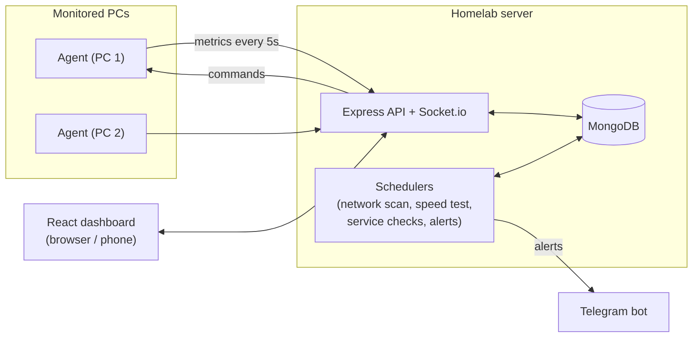

# Homelab Dashboard

A self-hosted dashboard to monitor and manage your PCs, home network, and home server from one place, with alerts on your phone.

Built with the MERN stack (MongoDB, Express, React, Node.js) as a Final Year Project.

> **Status:** in development. Milestones M0 (setup) and M1 (login + layout) are done. See the [roadmap](#roadmap).

---

## The problem

If you run a few PCs, a WiFi network, and a small server at home or in a lab, there is no single place to see what is happening:

- A PC gets slow or its disk fills up, and nobody notices until it breaks.
- Unknown devices join the WiFi.
- The internet goes down, and there is no record to show the ISP.
- A service stops, and nobody knows until someone complains.
- Backups are manual, so they get skipped.

Tools like Zabbix, Grafana, or Uptime Kuma each solve one part, but they are built for companies and take time to set up.

## Features

| Feature | Status |
|---|---|
| Secure login (JWT in httpOnly cookie, rate limited) | Done |
| Responsive dashboard with sidebar, dark / light / system theme | Done |
| Live PC monitoring: CPU, RAM, disk, temperature, battery | Planned (M2) |
| Network scanner with alerts for unknown devices | Planned (M3) |
| Alerts on your phone through a Telegram bot | Planned (M4) |
| Internet speed and downtime history | Planned (M5) |
| Website and service uptime checks | Planned (M5) |
| Remote lock, restart, shutdown (whitelisted, audited) | Planned (M6) |
| Scheduled backups with restore | Planned (M7) |

## Tech stack

| Part | Technology |
|---|---|
| Frontend | React 19, Vite, Tailwind CSS 4, shadcn/ui, TanStack Query, TanStack Table, React Router, Recharts |
| Backend | Node.js, Express 5, Mongoose, Zod, JWT, bcryptjs, Helmet |
| Database | MongoDB |
| Real-time | Socket.io (planned) |
| Agent | Node.js script on each monitored PC |
| Alerts | Telegram bot (planned) |
| Tooling | npm, oxlint, Prettier, nodemon |

## How it works



- A small **agent** runs on every PC and sends live metrics to the server.
- The **server** stores history, runs scheduled checks, and sends alerts.
- The **dashboard** shows everything live and lets you act on it.

The full design (flows, database, API, UI, security) is in [PLAN.md](PLAN.md).

## Project structure

```text
homelab-dashboard/
├── client/     React dashboard (Vite)
├── server/     Express API, MongoDB models, auth
├── agent/      Runs on each monitored PC
├── PLAN.md     Full project plan and design
├── PENDING.md  Tasks still to do
└── DONE.md     Completed tasks
```

## Getting started

### Requirements

- [Node.js](https://nodejs.org/) 22 or newer
- [MongoDB](https://www.mongodb.com/try/download/community) running locally, or a free [MongoDB Atlas](https://www.mongodb.com/atlas) cluster
- Git

### 1. Clone and install

```bash
git clone https://github.com/ahmadghouri/homelab-dashboard.git
cd homelab-dashboard

cd server && npm install && cd ..
cd client && npm install && cd ..
cd agent && npm install && cd ..
```

### 2. Configure the server

Copy the example environment file:

```bash
cd server
cp .env.example .env
```

Then edit `server/.env`:

| Variable | What to put |
|---|---|
| `MONGODB_URI` | Your MongoDB connection string. Local default: `mongodb://127.0.0.1:27017/homelab` |
| `JWT_SECRET` | A random string of at least 32 characters (command below) |
| `CLIENT_ORIGIN` | Dashboard URL. Default: `http://localhost:5173` |

Generate a `JWT_SECRET`:

```bash
node -e "console.log(require('node:crypto').randomBytes(48).toString('base64url'))"
```

### 3. Create the first admin

```bash
cd server
npm run create-admin -- --email you@example.com --name "Your Name"
```

A strong random password is printed once. To choose your own password, set `ADMIN_PASSWORD` before running the command.

### 4. Run

Use two terminals:

```bash
# Terminal 1
cd server
npm run dev        # API on http://localhost:4000

# Terminal 2
cd client
npm run dev        # Dashboard on http://localhost:5173
```

Open **http://localhost:5173** and sign in.

## Scripts

| Package | Command | What it does |
|---|---|---|
| server | `npm run dev` | Start the API with auto reload |
| server | `npm start` | Start the API |
| server | `npm run create-admin` | Create an admin user |
| server | `npm run lint` | Lint the code |
| client | `npm run dev` | Start the dashboard with hot reload |
| client | `npm run build` | Build for production into `client/dist` |
| client | `npm run lint` | Lint the code |
| agent | `npm run dev` | Start the agent with auto reload |

## API

| Method | Route | Auth | Description |
|---|---|---|---|
| GET | `/api/health` | No | Server and database status |
| POST | `/api/auth/login` | No | Sign in, sets the session cookie |
| POST | `/api/auth/logout` | No | Sign out, clears the cookie |
| GET | `/api/auth/me` | Yes | Current user |

The full planned API is in [PLAN.md, section 9](PLAN.md#9-api-design-rest).

## Security

- Passwords are hashed with bcrypt and never returned by the API.
- The session token is in an `httpOnly`, `SameSite=strict` cookie, so page scripts cannot read it.
- Login is rate limited (5 failed attempts per 15 minutes).
- All request bodies are validated on the server.
- Secrets live only in `.env`, which is not committed.
- Remote PC commands will be limited to a fixed whitelist and logged.

For remote access, use a VPN such as Tailscale or WireGuard instead of opening ports to the internet.

## Roadmap

| Milestone | Scope | Status |
|---|---|---|
| M0 | Planning and project setup | Done |
| M1 | Login and base layout | Done |
| M2 | Agent and live PC monitoring | Next |
| M3 | Network scanner | Planned |
| M4 | Alerts and Telegram | Planned |
| M5 | Internet and service monitoring | Planned |
| M6 | Remote commands | Planned |
| M7 | Backups | Planned |
| M8 | Testing, security, polish | Planned |
| M9 | Deployment and documentation | Planned |

Detailed tasks are in [PENDING.md](PENDING.md). Completed work is in [DONE.md](DONE.md).
