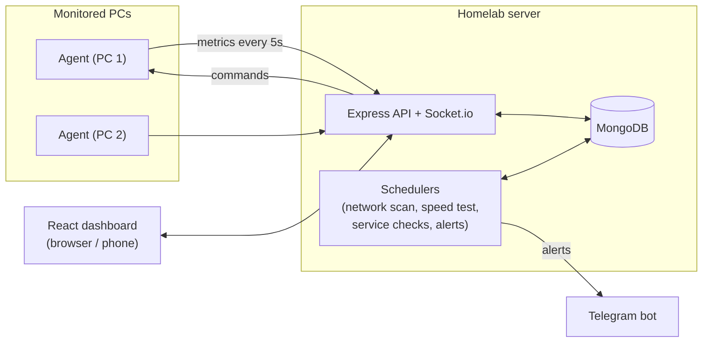

# Homelab Dashboard

A self-hosted dashboard to monitor and manage your PCs, home network, and home server from one place, with alerts on your phone.

Built with the MERN stack (MongoDB, Express, React, Node.js) as a Final Year Project.

> **Status:** in development. Login, live PC monitoring, network scanner, alerts, internet and service monitoring, and remote power actions, developer workspace manager, network map and ISP report, optional router / DNS integration, the Multi-Link Manager, and Drive (pooled Google Drive storage) (M0 to M11) are done. See the [roadmap](#roadmap).

---

## The problem

If you run a few PCs, a WiFi network, and a small server at home or in a lab, there is no single place to see what is happening:

- A PC gets slow or its disk fills up, and nobody notices until it breaks.
- Unknown devices join the WiFi.
- The internet goes down, and there is no record to show the ISP.
- A service stops, and nobody knows until someone complains.

Tools like Zabbix, Grafana, or Uptime Kuma each solve one part, but they are built for companies and take time to set up.

## Features

| Feature | Status |
|---|---|
| Secure login (JWT in httpOnly cookie, rate limited) | Done |
| Responsive dashboard with sidebar, dark / light / system theme | Done |
| Live PC monitoring: CPU, RAM, disk, network, battery, top processes | Done |
| Usage history charts (1 hour, 24 hours, 7 days) | Done |
| Offline detection within about 20 seconds | Done |
| Network scanner: every device on the network with vendor, no admin rights needed | Done |
| Alerts: high CPU / RAM / disk / temperature, PC offline, unknown network device | Done |
| Alerts on your phone through a Telegram bot | Done |
| Users with admin and viewer roles, change password | Done |
| Internet speed tests, connection checks, and outage history | Done |
| Website and TCP service uptime checks with response time | Done |
| Remote lock, restart, shutdown (whitelisted, off by default, logged) | Done |
| Developer workspace manager: start / stop dev projects, Docker, OS services, ports and conflicts, live logs | Done |
| Network topology map, packet loss monitor, monthly ISP PDF report | Done |
| MikroTik router: per-device usage, priority, block, WAN lines (optional) | Done (tested with a mock router) |
| AdGuard Home DNS ad blocking stats and switch (optional) | Done (tested with a mock server) |
| Use Wi-Fi, Ethernet, and phone tethering together (Multi-Link proxy) | Done |
| Drive: pool any number of Google Drive accounts into one file store (upload any file type, preview, share links, trash) | Done (tested with a mock Google server) |
| Drive: per-user access (view, download, upload, delete, share; all or selected folders), set by the admin | Done |

## Tech stack

| Part | Technology |
|---|---|
| Frontend | React 19, Vite, Tailwind CSS 4, shadcn/ui, TanStack Query, TanStack Table, React Router, Recharts |
| Backend | Node.js, Express 5, Mongoose, Zod, JWT, bcryptjs, Helmet |
| Database | MongoDB |
| Real-time | Socket.io |
| Agent | Node.js with `systeminformation`, runs on each monitored PC |
| Alerts | Telegram Bot API |
| Network scan | UDP sweep + ARP table, IEEE vendor list (`oui-data`) |
| Tooling | npm, oxlint, Prettier, nodemon |

## How it works



- A small **agent** runs on every PC and sends live metrics to the server.
- The **server** stores history, runs scheduled checks, and sends alerts.
- The **dashboard** shows everything live and lets you act on it.

The full design (flows, database, API, UI, security) is in [PLAN.md](PLAN.md).

## Project structure

```text
homelab-dashboard/
├── client/     React dashboard (Vite)
├── server/     Express API, MongoDB models, auth
├── agent/      Runs on each monitored PC
├── PLAN.md     Full project plan and design
├── PENDING.md  Tasks still to do
└── DONE.md     Completed tasks
```

## Getting started

### Requirements

- [Node.js](https://nodejs.org/) 22 or newer
- [MongoDB](https://www.mongodb.com/try/download/community) running locally, or a free [MongoDB Atlas](https://www.mongodb.com/atlas) cluster
- Git

### 1. Clone and install

```bash
git clone https://github.com/ahmadghouri/homelab-dashboard.git
cd homelab-dashboard

cd server && npm install && cd ..
cd client && npm install && cd ..
cd agent && npm install && cd ..
```

### 2. Configure the server

Copy the example environment file:

```bash
cd server
cp .env.example .env
```

Then edit `server/.env`:

| Variable | What to put |
|---|---|
| `MONGODB_URI` | Your MongoDB connection string. Local default: `mongodb://127.0.0.1:27017/homelab` |
| `JWT_SECRET` | A random string of at least 32 characters (command below) |
| `CLIENT_ORIGIN` | Dashboard URL. Default: `http://localhost:5173` |

Generate a `JWT_SECRET`:

```bash
node -e "console.log(require('node:crypto').randomBytes(48).toString('base64url'))"
```

### 3. Create the first admin

```bash
cd server
npm run create-admin -- --email you@example.com --name "Your Name"
```

A strong random password is printed once. To choose your own password, set `ADMIN_PASSWORD` before running the command.

### 4. Run

Use two terminals:

```bash
# Terminal 1
cd server
npm run dev        # API on http://localhost:4000

# Terminal 2
cd client
npm run dev        # Dashboard on http://localhost:5173
```

Open **http://localhost:5173** and sign in.

### 5. Connect a PC

1. In the dashboard, open **Devices** and click **Add device**.
2. Copy the settings shown in the dialog into `agent/.env` on that PC (the token is shown only once).
3. Start the agent:

```bash
cd agent
npm install
npm start
```

The PC shows as **Online** within a few seconds. On another PC, replace `localhost` in `SERVER_URL` with the IP address of the computer running the server.

> CPU temperature on Windows needs the agent to run with administrator rights. Without them it shows N/A.

**Power actions** (lock, restart, shutdown) are off on every PC by default. To allow them on a PC, add `REMOTE_COMMANDS=on` to that PC's `agent/.env` and restart its agent. Restart and shutdown wait 60 seconds, so they can be cancelled from the dashboard. For testing, `REMOTE_COMMANDS_DRY_RUN=true` makes the agent report what it would run without running it.

### 6. Phone alerts with Telegram (optional)

1. In Telegram, open **@BotFather**, send `/newbot`, and follow the steps. You get a bot token.
2. Add it to `server/.env`: `TELEGRAM_BOT_TOKEN=...` and restart the server.
3. Send `/start` to your new bot in Telegram.
4. In the dashboard, open **Settings > Notifications**, click **Find my chat**, pick your chat, turn on **Send alerts to Telegram**, and save.
5. Click **Send test message**.

Without a bot token, alerts still show in the dashboard (bell icon, Alerts page, and pop-up messages).

### Developer workspace (optional, per PC)

1. Copy `agent/workspace.example.json` to `agent/workspace.json` and list your projects (folder, start command, port) and services (for example MongoDB).
2. Add `WORKSPACE_CONTROL=on` to that PC's `agent/.env` to allow start / stop / restart and log viewing from the dashboard (status and ports are always shown).
3. Run the agent with `npm start`. Projects keep running when the agent stops. On Windows, project output is kept in `%TEMP%homelab-agentprojects`.

### Router and DNS ad blocking (optional, your own router only)

- MikroTik (RouterOS 7.1+): turn on the REST API (`/ip service enable www-ssl`), create a dedicated user, for example `/user group add name=dashboard policy=read,write,api,rest-api` and `/user add name=dashboard group=dashboard password=...`, then set `ROUTER_TYPE=mikrotik`, `ROUTER_URL`, `ROUTER_USER`, `ROUTER_PASSWORD` (and `ROUTER_TLS_INSECURE=true` only for the router's own self-signed certificate) in `server/.env` and restart the server. Blocking adds a drop rule at the top of the forward chain and the `homelab-blocked` address list.
- AdGuard Home: set `ADGUARD_URL`, `ADGUARD_USER`, `ADGUARD_PASSWORD` in `server/.env` and point your router's DHCP DNS at AdGuard Home.

The internet quality monitor pings your default gateway and 1.1.1.1 every minute (10 pings each) for packet loss and latency.

### Multi-Link: use several internet lines on one PC (optional)

1. Connect the extra lines: an Ethernet cable and your phone by **USB tethering** (one Wi-Fi card can join only one Wi-Fi network).
2. Add `MULTILINK=on` to that PC's `agent/.env` and restart the agent.
3. Set the Windows proxy: Settings > Network & internet > Proxy > Manual proxy setup, address `127.0.0.1`, port `8080` (or point Firefox / other apps at SOCKS5 `127.0.0.1:1080`).
4. On the **Multi-Link** page choose a mode (Balanced, Weighted by speed, Failover), set roles (a phone line starts as Backup) and data caps (decimal GB).

Each new connection goes over one of the working lines, so many connections at once (browser tabs, download managers like IDM) use all lines together. Limits: one connection always uses one line (a single video, call, or single-connection download is not faster), websites may see different IP addresses (Sticky helps), and only apps that use the proxy are balanced. The proxy listens on 127.0.0.1 only and the agent never changes Windows network settings.

### Drive: pooled Google Drive storage (optional)

1. In [Google Cloud Console](https://console.cloud.google.com/) create a project, turn on the **Google Drive API**, and set up the OAuth consent screen (External, add your Google accounts as test users).
2. Create an **OAuth client ID** of type *Web application* with the redirect URI `http://localhost:4000/api/storage/google/callback`.
3. Put `GOOGLE_CLIENT_ID` and `GOOGLE_CLIENT_SECRET` in `server/.env` and restart the server. Optional: `STORAGE_ENCRYPTION_KEY`, `STORAGE_MAX_UPLOAD_GB` (default 10), `STORAGE_TRASH_DAYS` (default 30).
4. Open **Drive > Accounts** and click **Connect Google Drive** for each account. Their space is added together.
5. Give users access in **Settings > Users > Drive access** (view, download, upload, delete, share; all folders or only selected ones). Admins always have full access.

The app uses the `drive.file` scope, so it can only see files it uploaded itself, not the rest of your Drive. Tokens are stored encrypted. Each file is stored in one account (the routing mode picks which), so one file must fit in one account's free space. While the Google app is in *Testing* mode, Google ends the connection after 7 days and the account must be reconnected.

### Network scanner

The server scans its own network every 5 minutes (change it in **Settings > Network**). It finds devices without admin rights by sending one small UDP packet to every address and then reading the ARP table. The first scan only builds the list; after that, every new device that is not trusted opens an alert. Mark your own devices as trusted on the **Network** page.

## Scripts

| Package | Command | What it does |
|---|---|---|
| server | `npm run dev` | Start the API with auto reload |
| server | `npm start` | Start the API |
| server | `npm run create-admin` | Create an admin user |
| server | `npm run lint` | Lint the code |
| client | `npm run dev` | Start the dashboard with hot reload |
| client | `npm run build` | Build for production into `client/dist` |
| client | `npm run lint` | Lint the code |
| agent | `npm start` | Start the agent |
| agent | `npm run dev` | Start the agent with auto reload |

## API

| Method | Route | Auth | Description |
|---|---|---|---|
| GET | `/api/health` | No | Server and database status |
| POST | `/api/auth/login` | No | Sign in, sets the session cookie |
| POST | `/api/auth/logout` | No | Sign out, clears the cookie |
| GET | `/api/auth/me` | Yes | Current user |
| GET | `/api/devices` | Yes | All PCs with their latest live metrics |
| POST | `/api/devices` | Admin | Add a PC, returns its agent token once |
| GET | `/api/devices/:id` | Yes | One PC |
| PATCH | `/api/devices/:id` | Admin | Rename a PC |
| DELETE | `/api/devices/:id` | Admin | Remove a PC and its history |
| POST | `/api/devices/:id/token` | Admin | Replace the agent token |
| GET | `/api/devices/:id/metrics?range=1h\|24h\|7d` | Yes | Usage history |

| POST | `/api/auth/change-password` | Yes | Change your password (signs out other sessions) |
| GET | `/api/network/devices` | Yes | Devices on the network and scan status |
| PATCH | `/api/network/devices/:id` | Admin | Rename, mark as trusted or unknown |
| DELETE | `/api/network/devices/:id` | Admin | Forget a device |
| POST | `/api/network/scan` | Admin | Scan now |
| GET | `/api/alerts?status=open\|resolved\|all` | Yes | Alerts and the open count |
| POST | `/api/alerts/:id/acknowledge` | Admin | Mark as seen |
| POST | `/api/alerts/:id/resolve` | Admin | Close by hand |
| GET | `/api/alert-rules` | Yes | Alert rules |
| PATCH | `/api/alert-rules/:id` | Admin | Turn on / off, change limit, wait time, severity |
| GET / PATCH | `/api/settings` | Admin | Telegram and network scan settings |
| POST | `/api/settings/telegram/test` | Admin | Send a test message |
| GET | `/api/settings/telegram/chats` | Admin | Find your chat ID |
| GET | `/api/internet/status` | Yes | Connection state and last speed test |
| GET | `/api/internet/speedtests?range=24h|7d|30d` | Yes | Speed test history |
| POST | `/api/internet/speedtests` | Admin | Run a speed test now (about 35 MB) |
| GET | `/api/internet/outages` | Yes | Internet outages |
| GET / POST | `/api/services` | Yes / Admin | List or add monitored services |
| PATCH / DELETE | `/api/services/:id` | Admin | Edit, pause, or delete a service |
| POST | `/api/services/:id/check` | Admin | Check now |
| GET | `/api/services/:id/checks?range=24h|7d` | Yes | Uptime and response time history |
| POST | `/api/devices/:id/commands` | Admin | Lock, restart, shut down, or cancel shutdown |
| GET | `/api/devices/:id/commands` | Yes | Command history |
| GET / POST | `/api/users` | Admin | List or add users |
| PATCH / DELETE | `/api/users/:id` | Admin | Change role or delete a user |
| GET | `/api/storage/accounts` | View access | Drive accounts and total space |
| GET | `/api/storage/google/connect-url` | Admin | Start connecting a Google account |
| PATCH / DELETE | `/api/storage/accounts/:id` | Admin | Accept uploads, priority, or disconnect |
| POST | `/api/storage/accounts/:id/sync` | Admin | Refresh an account's used space |
| GET / PUT | `/api/storage/routing` | Admin | Upload routing mode |
| GET | `/api/storage/me/access` | Yes | Your own Drive permissions |
| GET | `/api/storage/access` | Admin | Every user's Drive permissions |
| PUT | `/api/storage/access/:userId` | Admin | Set a user's Drive permissions |
| GET / POST | `/api/storage/folders` | Drive access | List or create folders |
| GET | `/api/storage/files?folderId=&q=&kind=` | Drive access | Files and folders, search |
| PATCH / DELETE | `/api/storage/files/:id` | Drive access | Rename, move, or move to trash |
| POST | `/api/storage/files/batch` | Drive access | Move or trash many items |
| GET / DELETE | `/api/storage/trash` | Drive access | List the trash or delete forever |
| POST | `/api/storage/trash/restore` | Drive access | Restore from the trash |
| POST / PUT / GET / DELETE | `/api/storage/uploads(/:id)` | Upload access | Resumable chunked upload |
| GET | `/api/storage/content/:fileId` | View access | File content (supports Range; `?download=1` needs download access) |
| POST | `/api/storage/files/:id/shares` | Share access | Create a share link |
| GET / DELETE | `/api/storage/shares(/:id)` | Share access | List or revoke share links |
| GET | `/api/public/shares/:token(/content)` | No | Open a share link (rate limited) |

Live updates use Socket.io: agents connect to the `/agent` namespace with their token, and the dashboard connects to `/dashboard` with the login cookie.

The full planned API is in [PLAN.md, section 9](PLAN.md#9-api-design-rest).

## Security

- Passwords are hashed with bcrypt and never returned by the API.
- The session token is in an `httpOnly`, `SameSite=strict` cookie, so page scripts cannot read it.
- Login is rate limited (5 failed attempts per 15 minutes).
- All request bodies are validated on the server.
- Agent tokens are random 256-bit values, stored only as a hash, and can be replaced at any time.
- Data sent by agents is validated like any other request.
- Changing a password signs out every other session.
- The last admin cannot be removed or demoted. Viewers can look but not change anything.
- The Telegram bot token stays in `.env`. MAC vendor lookup is offline, so device details never leave the server.
- Secrets live only in `.env`, which is not committed.
- Remote PC commands will be limited to a fixed whitelist and logged.
- Drive: only admins can connect Google accounts; Google tokens are encrypted (AES-256-GCM); Drive permissions are checked on the server for every request; share links are stored only as a hash and can expire; HTML, SVG, and script files are always downloaded instead of shown.

For remote access, use a VPN such as Tailscale or WireGuard instead of opening ports to the internet.

## Roadmap

| Milestone | Scope | Status |
|---|---|---|
| M0 | Planning and project setup | Done |
| M1 | Login and base layout | Done |
| M2 | Agent and live PC monitoring | Done |
| M3 | Network scanner | Done |
| M4 | Alerts and Telegram | Done |
| M5 | Internet and service monitoring | Done |
| M6 | Remote commands | Done |
| M7 | Developer workspace manager | Done |
| M8 | Network Pro (topology map, packet loss, ISP report) | Done |
| M9 | Router and DNS integration (optional) | Done |
| M10 | Multi-Link Manager (Wi-Fi + Ethernet + phone together) | Done |
| M11 | Drive (pooled Google Drive storage with per-user access) | Done |
| M12 | Testing, security, polish | Next |
| M13 | Deployment and documentation | Planned |

Detailed tasks are in [PENDING.md](PENDING.md). Completed work is in [DONE.md](DONE.md).
